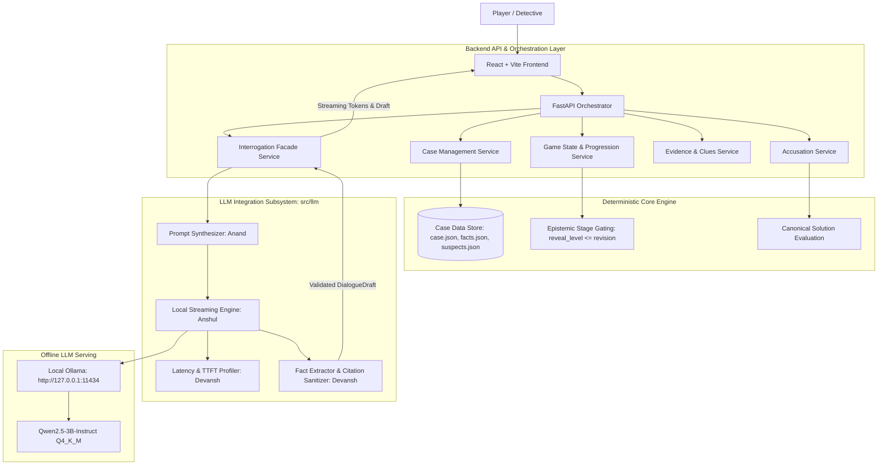

# RED THREAD — Dynamic AI-Driven Detective Game

**An AI-powered detective game built with deterministic case logic and local LLM-driven NPC conversations.**

**Team:** Team Quantum  
**Programme:** EPAM Centre of Excellence, LNCT  
**Project Domain:** Gaming · Generative AI · Conversational AI  
**Version:** 1.0.0 (Sprint 2 Candidate)  

---

## Overview

**Red Thread** is an AI-powered detective game where players investigate a complex mystery by exploring physical evidence, reviewing case notes, and interrogating non-player characters (NPCs) in real time.

NPCs respond naturally through a local Large Language Model (`Qwen2.5-3B-Instruct`). However, the LLM does not control the ground truth of the mystery. The Case Engine remains the sole authoritative source for case facts, NPC Knowledge filters what each character is permitted to know at the current game stage, and a multi-strategy extraction and validation layer ensures dialogue never leaks unrevealed spoilers or hallucinates evidence.

> **Core principle:** The Case Engine owns the truth. The LLM owns the voice. The validation layer protects the mystery.

---

## Key Features

### Investigation and Gameplay
- Immersive noir-themed landing and entry experience.
- Case selection supporting unlocked and progressive case states.
- Case dashboard displaying background briefs, victim profiles, and investigation milestones.
- Suspect directory with persistent character identifiers (`suspect_001`, `suspect_002`, `suspect_003`).
- Real-time NPC interrogation interface with typewriter streaming and token telemetry.
- Evidence board for analyzing and confronting suspects with clues.

### AI-Powered NPC Interrogation
- Suspect-specific context synthesized directly from backend contracts (`Suspect`, `DialogueRequest`).
- In-character responses reflecting sensory styles, personality traits, and psychological defense mechanisms.
- Strict prompt injection boundaries (`<player_question>` fences) protecting model directives against jailbreaks.
- Dynamic fact gating ensuring suspects only reference authorized facts (`reveal_level <= revision`).
- In-character deflection fallbacks when inference servers are unreachable or encounter errors.

### Case Integrity and Validation
- Deterministic case data stored as authoritative JSON datasets (`case.json`, `facts.json`, `clues.json`, `suspects.json`).
- Epistemic fact boundary enforcement preventing NPCs from accessing the full case solution prematurely.
- Multi-strategy output parser (`exact_json`, `markdown_fence`, `enclosed_object`, `fallback_regex`) guaranteeing zero unhandled parse crashes.
- Citation sanitizer automatically stripping out-of-bounds or hallucinated fact and clue IDs before state persistence.
- Final accusations evaluated strictly by deterministic backend rule-engines rather than non-deterministic LLMs.

### Evidence and Investigation State
- Stable identifiers across cases, suspects, facts, and physical evidence.
- Progressive evidence discovery rules tied to investigation milestones.
- Deduplicated evidence collection and timeline logging.
- Session-scoped investigation notes and conversation turn history.

---

## System Architecture

The system decouples deterministic narrative logic from conversational AI generation. Case truths, progression triggers, and epistemic fact permissions are strictly evaluated by Python backend contracts, while local LLM models (Qwen 2.5 3B via Ollama / llama.cpp) handle character roleplay within strictly fenced epistemic boundaries.



### Main Components

| Component | Lead / Owner | Responsibility |
|---|---|---|
| **Frontend UI** | Frontend Team | React 18 / Vite screens, interrogation chat, evidence board, typewriter rendering |
| **Backend API** | Backend Team | FastAPI endpoints, session orchestration, request validation, business logic |
| **Case Engine** | Core Logic Team | Authoritative case store, progression stage transitions, accusation checks |
| **Prompt Synthesizer** | Anand Kumar Sahni | Dynamic prompt assembly, sensory voice directives, prompt injection isolation |
| **Engine Runner** | Anshul Prajapati | Local Ollama / llama.cpp socket streaming, model quantization, KV cache tuning |
| **Extractor & Profiler** | Devansh Vinayak | Multi-strategy JSON parsing, `<think>` stripping, citation sanitization, TTFT SLA profiling |
| **Interrogation Facade** | Devansh Vinayak | Single-point unified service (`InterrogationService`) connecting backend to LLM pipeline |

---

## Technology Stack

| Layer | Technology | Purpose |
|---|---|---|
| **Frontend** | React 18 + Vite (TypeScript) | Responsive game client, cyber-noir UI, typewriter streaming |
| **Styling** | Tailwind CSS + Lucide Icons | Dark-mode detective aesthetic, evidence board layouts |
| **Backend API** | FastAPI / Python 3.12 | REST API endpoints, SSE typewriter streaming, state orchestration |
| **Data Contracts** | Pydantic V2 & Python Data Classes | Strict type validation, immutable contracts (`DialogueRequest`, `DialogueDraft`) |
| **Case Storage** | JSON File Store / SQLite | Canonical case facts, clue definitions, progression milestones |
| **LLM Inference** | Ollama / llama.cpp (`127.0.0.1:11434`) | 100% offline local inference on consumer hardware (sub-800ms TTFT) |
| **Target Model** | `Qwen2.5-3B-Instruct` (`Q4_K_M`) | High instruction-following fidelity, compact ~2.1 GB VRAM footprint |
| **Testing** | `pytest 8.3.3`, `pytest-asyncio` | Unit tests, contract verification, mock streaming tests (100% passing) |
| **Version Control** | Git & GitHub | Distributed version control, PR staging (`red_thread_fork`) |
| **Design System** | Figma | UI/UX visual guidelines, typography, and color tokens |

---

## API Overview

All endpoints communicate via standard JSON payloads and UTF-8 encoding:

| Method | Endpoint | Description |
|---|---|---|
| `GET` | `/api/cases` | List all available investigation cases and completion status |
| `GET` | `/api/cases/{case_id}` | Retrieve case brief, victim background, and public metadata |
| `POST` | `/api/cases/{case_id}/start` | Initialize or resume an investigation session |
| `GET` | `/api/cases/{case_id}/suspects` | List all suspects and persons of interest for the active case |
| `POST` | `/api/dialogue/interrogate` | Send interrogation question to suspect; returns complete `DialogueDraft` |
| `POST` | `/api/dialogue/stream` | Stream interrogation tokens in real time via Server-Sent Events (SSE) |
| `GET` | `/api/cases/{case_id}/evidence` | List all discovered and confrontable physical clues |
| `POST` | `/api/cases/{case_id}/evidence/collect` | Log newly discovered evidence into player notebook |
| `GET` | `/api/notes` | Retrieve detective notebook entries and timeline notes |
| `PUT` | `/api/notes` | Create or update case investigation notes |
| `POST` | `/api/cases/{case_id}/accuse` | Submit final accusation and trigger canonical case resolution |
| `GET` | `/api/progression` | Query current investigation stage, revision count, and unlocked facts |

### Example Interrogation Request

```json
{
  "request_id": "req_turn_001",
  "case_id": "case_001",
  "suspect_id": "suspect_001",
  "player_message": "Did you hear anything unusual outside your apartment around 9:40 PM?",
  "authorized_fact_ids": ["fact_001", "fact_010"],
  "presented_clue_ids": ["clue_006"]
}
```

### Example Interrogation Response

```json
{
  "request_id": "req_turn_001",
  "suspect_id": "suspect_001",
  "content": "I remember the rhythm of footsteps in the corridor at 9:40 PM. Because of my eyesight, I focus on acoustics; I cannot tell you who was walking, only that their stride was hurried.",
  "cited_fact_ids": ["fact_001"],
  "cited_clue_ids": ["clue_006"],
  "metrics": {
    "model_id": "qwen2.5:3b-instruct-q4_K_M",
    "time_to_first_token_ms": 45.96,
    "generation_time_ms": 611.89,
    "prompt_tokens": 512,
    "completion_tokens": 34
  }
}
```

### Standard Error Codes

- `CASE_NOT_FOUND`: Specified `case_id` does not exist in case repository.
- `CASE_LOCKED`: Attempted to access a case before completing prerequisites.
- `SUSPECT_NOT_FOUND`: Target `suspect_id` is invalid for the active case.
- `EVIDENCE_NOT_FOUND`: Presented clue ID does not exist in discovered evidence.
- `DIALOGUE_REQUEST_MALFORMED`: Required contract fields missing or improperly typed.
- `ENGINE_UNAVAILABLE`: Local Ollama / llama.cpp engine is offline or unreachable.
- `ENGINE_TIMEOUT`: Model response exceeded maximum latency deadline.
- `UNAUTHORIZED_FACT`: Attempted to inject fact IDs not unlocked at current progression stage.

---

## Pages and User Experience

| Screen | Purpose | Sprint 2 Target |
|---|---|:---:|
| **Landing** | Title screen, cinematic prologue, entry action | Must have |
| **Login / Session** | Player profile identification and guest play session | Must have |
| **Case Selection** | Browse playable cases (`Case 001: The Silent Witness`) | Must have |
| **Game Dashboard** | Case brief, active suspects, investigation timeline | Must have |
| **Suspect Directory** | Review suspect dossiers, alibis, and relationships | Must have |
| **Interrogation Room** | Real-time chat with typewriter text generation and fact tagging | Must have |
| **Evidence Board** | Pinboard of physical clues and evidence confrontation cards | Must have |
| **Investigation Notes** | Player notepad for hypothesis tracking and deduction logs | Sprint 3 |
| **Solve the Case** | Accusation builder: select culprit, motive, and murder weapon | Sprint 3 |

---

## Getting Started

### Prerequisites

- **Python:** Python 3.10+ (tested and certified on **Python 3.12.0**)
- **Node.js:** Node.js 18+ and npm (for React/Vite frontend)
- **Local Inference Engine:** [Ollama](https://ollama.ai) (Windows installer)
- **GPU Hardware:** NVIDIA GPU with 6GB+ VRAM recommended (tested on NVIDIA GeForce RTX 4050 Laptop GPU, 6GB GDDR6, CUDA 13.5). CPU mode is also supported.

### Setup Instructions

#### 1. Setup Local LLM Engine
Ensure Ollama is running and pull the certified 3B parameter model:

```powershell
# Pull certified Qwen 2.5 3B model (~2.1 GB)
ollama pull qwen2.5:3b

# Verify installation
ollama list
```

#### 2. Setup Backend Subsystem

```powershell
cd D:\red_thread\backend

# Install core dependencies
pip install pytest pydantic requests

# Run all 29 automated test suites
python -m pytest tests/ -v
```

#### 3. Run Streaming Latency Benchmark

```powershell
# Run 50 live inference turns against Ollama
python -m benchmarks.run_latency_benchmark --turns 50 --output benchmarks/sprint2_benchmark_report.csv

# Launch interactive Chart.js performance visualizer
python -m benchmarks.visualize_performance --open
```

---

## Benchmark & Telemetry Summary

The LLM Integration pipeline was evaluated over 50 consecutive live streaming turns against local Ollama running `qwen2.5:3b`:

| Metric | Measured Result | Sprint 2 SLA Target | Status |
|---|---|---|:---:|
| **Time to First Token (Mean TTFT)** | **45.96 ms** | < 800.0 ms | **PASSED (17.4x margin)** |
| **95th Percentile Latency (P95 TTFT)** | **72.47 ms** | < 800.0 ms | **PASSED** |
| **SLA Compliance Rate** | **100.0% (50/50 turns)** | &ge; 95.0% | **PASSED** |
| **Decoding Throughput** | **30.92 tokens/sec** | > 20.0 tok/s | **PASSED** |
| **JSON Parse Reliability** | **100.0% (Zero Crashes)** | 100% Robustness | **PASSED** |
| **Fact Citation Security** | **100% Gated** | Zero Hallucinations | **PASSED** |

---

## Acknowledgement

Developed by **Team Quantum** as part of the **EPAM Centre of Excellence at LNCT**.

## License

Academic project developed for the EPAM Centre of Excellence programme. All rights reserved by the respective project contributors and institution.
