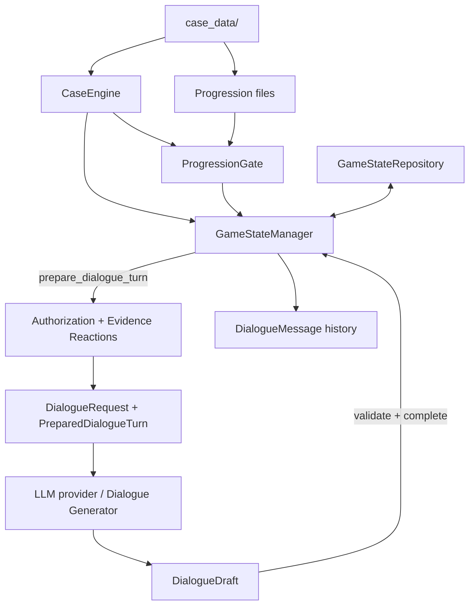
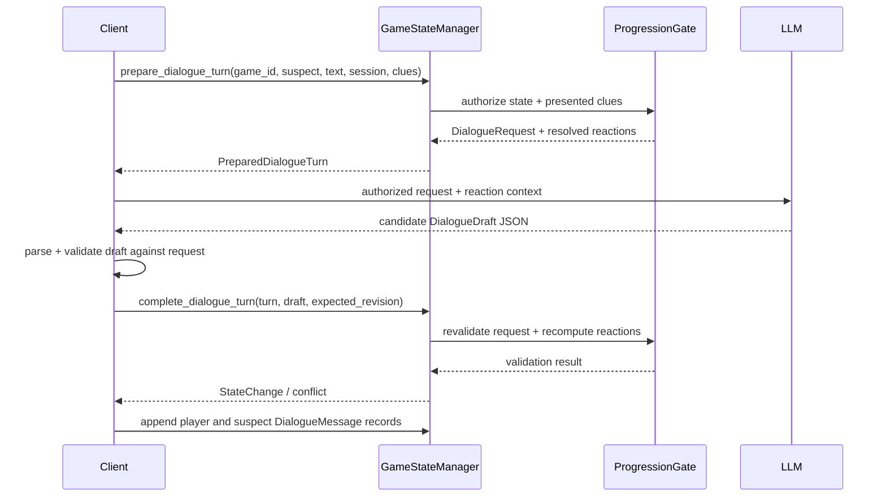

# LLM Integration — Master Guide

## 1. Goal and trust boundaries

The LLM is a **dialogue renderer**, not the authority for case truth or game progression.

The backend owns:

- Canonical case data.
- Current player state.
- Clue discovery.
- Stage progression.
- NPC knowledge.
- Evidence reaction eligibility.
- Fact authorization.

The LLM receives a bounded, authorized request and produces a candidate response.

The key invariant is:

**The model can phrase authorized information; it cannot grant itself access to additional information.**

## 2. Component map



## 3. Responsibility matrix

| Component | Owns | Must not own |
|---|---|---|
| Case Engine | Canonical records, validation, lookup and temporal relationships | Player progress, NPC permissions, dialogue generation |
| Case Data | Authored case facts, clues, suspects, timeline, stages and NPC knowledge | Runtime state or executable policy |
| Shared Contracts | Typed interfaces and validation between modules | Business decisions or LLM prompt policy |
| Progression | Stage requirements, unlocks, NPC knowledge and authorization | Persisted sessions or natural-language generation |
| Game State | Session lifecycle, history and validated state transitions | Defining stage requirements or bypassing authorization |
| LLM integration | Prompt construction from authorized inputs, inference, parsing and candidate draft | Deciding facts are authorized, unlocking clues/stages or mutating game state directly |

## 4. Bootstrap the backend

```python
from src.case_engine import CaseEngine
from src.progression import ProgressionGate
from src.game_state import GameStateManager, InMemoryGameStateRepository

engine = CaseEngine.load("case_001")
gate = ProgressionGate.from_engine(engine)

repository = InMemoryGameStateRepository()

games = GameStateManager(
    engine,
    repository,
    gate
)

state = games.create_game_session()
```

Use a durable implementation of `GameStateRepository` in production.

The in-memory repository is not durable.

## 5. Dialogue request/response lifecycle



### Input to the model

The canonical input object is:

`shared.contracts.dialogue.DialogueRequest`

Its fields include:

- `authorized_fact_ids`: computed by the backend.
- `presented_clue_ids`: clues verified as discovered and eligible for presentation.
- `dialogue_history`: bounded recent history for the selected dialogue session.
- `player_message`: current player input.
- `suspect_id`: target NPC.
- `generation_limits`: generation configuration.

Evidence reactions are returned separately in:

`PreparedDialogueTurn.reactions`

Pass their relevant fields to the dialogue prompt without treating them as new canonical facts.

The backend contract does not define a provider-specific prompt string or a particular Ollama/OpenAI SDK call.

The integration team owns that adapter while preserving the contract boundary.

### Output from the model

Parse the model output into `DialogueDraft` with:

- Same `request_id` as the request.
- Same `suspect_id` as the request.
- Generated `content`.
- `cited_fact_ids` drawn only from `request.authorized_fact_ids`.
- `cited_clue_ids` drawn only from `request.presented_clue_ids`.
- `GenerationMetrics` populated from actual inference telemetry where available.

Use:

- `DialogueDraft.from_json()`
- `DialogueDraft.from_dict()`
- `draft.validate_against_request(request)`

Do not accept model-supplied authorization fields.

## 6. Evidence confrontation handling

When the player presents a clue:

1. Send its ID in `presented_clue_ids`.
2. Do not send arbitrary clue text as proof of discovery.
3. The backend verifies discovery.
4. The backend resolves the target suspect's configured reaction.
5. The prompt instructs the model to express the supplied reaction and respect its `limits`.

The LLM must not invent:

- New admissions.
- Alibi changes.
- Hidden facts.
- Reactions not supplied by the backend.

One-time reactions are tracked by the backend and checked again when the turn is completed.

## 7. Persistence and ordering

`complete_dialogue_turn`:

- Validates the draft.
- Revalidates authorization.
- Checks for stale state.
- Records applicable one-time reaction markers.

It does not append the dialogue messages.

Persist the player message and generated suspect response separately as `DialogueMessage` objects through:

`append_dialogue_message`

Sequence numbers must increase within each `dialogue_session_id`.

Use unique message IDs.

Keep the complete history in storage and send only a bounded recent window to the LLM.

## 8. State changes outside dialogue

- On a genuine clue discovery, call `GameStateManager.discover_clue`; do not append the clue ID directly to state.
- On completion of an interview, call `record_interview`; opening or continuing a conversation is not sufficient.
- Let the manager evaluate progression and persist the result.
- Do not let the LLM or client create `stage:` or `reaction:` markers.

## 9. Integration checklist

- [ ] Bootstrap uses one shared `CaseEngine` instance for the gate and state manager.
- [ ] `ProgressionGate.from_engine` loads the case-specific progression and NPC knowledge files.
- [ ] Every turn is prepared by `GameStateManager`/Progression authorization.
- [ ] LLM context contains only authorized facts, eligible presented clues, bounded history and resolved reactions.
- [ ] Model output is parsed into `DialogueDraft` and validated.
- [ ] `complete_dialogue_turn` is called with the original `PreparedDialogueTurn`.
- [ ] Player and suspect messages are persisted as `DialogueMessage` records.
- [ ] Clue discovery and interview completion use dedicated state-manager methods.
- [ ] Revision conflicts and stale turns are handled by reloading and preparing a new turn.
- [ ] Tests cover unauthorized citations, unknown/locked clues, NPC knowledge limits, one-time reactions and stale revisions.

## 10. Suggested ownership split for the LLM team

### 1. Backend adapter
- Calls `prepare_dialogue_turn`.
- Translates the contract into the provider prompt.
- Invokes the model.
- Parses the result.

### 2. Prompt/context engineer
- Defines response style.
- Defines character voice.
- Determines how to express supplied evidence reactions without exceeding their limits.

### 3. Output validator
- Enforces strict JSON/contract parsing.
- Enforces citation constraints.
- Never implements its own authorization policy.

### 4. Telemetry/benchmark owner
- Records model ID.
- Measures TTFT.
- Measures generation duration.
- Records token counts in `GenerationMetrics` and the existing profiler.

### 5. Integration/QA owner
- Tests the full prepare → infer → validate → complete → persist flow.
- Tests failure and concurrency paths.

These are suggested work boundaries. They do not change the existing module ownership described above.
