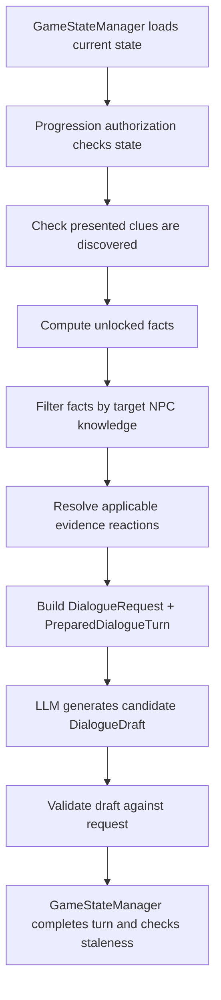

# Progression and Authorization

## 1. Purpose

`src/progression/` is the backend policy layer for investigation progression and NPC knowledge.

It decides:

- Which clues are discoverable.
- Which facts are unlocked.
- Which facts a particular suspect may know.
- How that suspect reacts to presented evidence.

It is a deterministic rules layer. It does not generate dialogue or own the persisted game session.

## 2. Files

| File | Responsibility |
|---|---|
| `progression_rules.py` | `StageRule`, `ProgressionRules`, stage markers, rule loading/validation and unlock calculations. |
| `knowledge.py` | Loads per-suspect knowledge and reaction data from `npc_knowledge.json`. |
| `evidence_reactions.py` | Validates authored reaction mappings and resolves them into safe `ResolvedReaction` objects. |
| `authorization.py` | Enforces clue/fact/NPC authorization and builds validated `DialogueRequest` objects. |
| `progression_manager.py` | Evaluates requirements and advances stages on immutable `GameState` values. |
| `gate.py` | Convenience bundle of manager and authorization service. |
| `__init__.py` | Public exports. |

## 3. Initialization

```python
from src.case_engine import CaseEngine
from src.progression import ProgressionGate

engine = CaseEngine.load("case_001")
gate = ProgressionGate.from_engine(engine)

manager = gate.manager
authorization = gate.authorization
```

`ProgressionGate.from_engine(engine, rules=None, data_root=None, knowledge=None)` loads:

- `progression.json`
- `npc_knowledge.json`

by default.

Explicit rules/knowledge are mainly for tests and tools.

Initialization validates that:

- Rules belong to the engine's case.
- Every suspect has knowledge.
- All referenced IDs are valid.
- Evidence reaction references are valid.

## 4. Progression rules

A `StageRule` includes:

- `stage_id`
- `title`
- `description`
- `required_clue_ids`
- `required_interviewed_suspect_ids`
- `required_objective_ids`
- `unlocks_clue_ids`
- `unlocks_fact_ids`
- `schema_version`

The stage list order is authoritative.

The first stage has no requirements and is implicit in a new game.

Unlocking a later stage records a backend-owned marker in:

`GameState.completed_objective_ids`

Marker format:

`stage:<stage_id>`

`evaluate(state)` may unlock multiple consecutive stages if all requirements are met, but cannot skip a stage.

Re-evaluation is idempotent.

### Key helpers

- `load_progression_rules(engine, data_root=None)`
- `rules_from_dict(data, case_id)`
- `default_rules(engine)` — fallback rules when no authored progression file is present. Do not rely on fallback when case-specific progression is required.
- `current_stage(state, rules)`
- `unlocked_stage_ids(state, rules)`
- `is_stage_reached(state, rules, stage_id)`
- `unmet_requirements(rule, state)`
- `stage_marker(stage_id)`

## 5. Progression manager API

`ProgressionManager` is exposed as `gate.manager`.

Functions:

- `initial_state(game_id)` — create a `GameState` at the initial stage.
- `get_current_stage(state)` — return current `StageRule`.
- `evaluate(state)` — return `ProgressionResult`. Result includes new state, previous/current stage IDs, newly unlocked stages, next stage and unmet requirements.
- `unlock_stage(state, stage_id)` — explicit guarded unlock; cannot skip stages or bypass requirements.
- `record_interview(state, suspect_id)` — record interview in a returned state; duplicate interview is a no-op.
- `discover_clue(state, clue_id)` — record a clue only if currently discoverable. Stage evaluation is a separate call at this lower-level API.

In normal application flow, use `GameStateManager` for persisted transitions. It coordinates progression evaluation and revision updates.

## 6. Clue and fact authorization

`AuthorizationService` (`gate.authorization`) is the security boundary for dialogue context.

Important methods:

- `validate_state(state)` — verifies case ownership and all referenced IDs/stage markers.
- `is_clue_unlocked(state, clue_id)` / `unlocked_clue_ids(state)` — stage/interview gate status.
- `discoverable_clue_ids(state)` — clues currently available to discover.
- `require_clue_discoverable(state, clue_id)` — reject attempts to discover locked clues.
- `require_clue_presentable(state, clue_id)` — require a clue to be discovered before it can be presented in dialogue.
- `unlocked_fact_ids(state)` — facts currently unlocked globally by progression/discovery policy.
- `authorize_facts(state, suspect_id)` — intersect unlocked facts with that NPC's permitted known/secret facts.
- `authorize_dialogue(state, suspect_id, presented_clue_ids=())` — return the backend's authorization decision.
- `build_dialogue_request(...)` — construct the shared `DialogueRequest` with authorized fact IDs computed internally. There is deliberately no caller-supplied fact-ID argument.
- `resolve_evidence_reactions(state, suspect_id, presented_clue_ids)` — return only applicable reactions and filter reveal/conceal facts against authorized facts.
- `prepare_dialogue_turn(...)` — package a `DialogueRequest` and resolved reactions as `PreparedDialogueTurn`.
- `validate_dialogue_request(state, request)` — re-check that a request is still valid for the current state.

### Fact authorization logic

A fact must pass all relevant checks:

1. It exists in the loaded case.
2. It is unlocked:
   - A stage-gated fact requires its stage.
   - Clue-linked facts require an appropriate discovered clue.
   - Baseline facts are handled by the authorization service's baseline rule.
3. The target suspect explicitly permits it through `known_fact_ids` or `secret_fact_ids`.

Unknown or unlisted facts are not permitted.

The exact ordering and filtering are implemented in `authorization.py`.

Do not reproduce a simplified or independent authorization algorithm inside the LLM service.

## 7. Evidence reactions

An authored reaction is keyed by suspect and clue.

It can specify:

- Reaction type.
- Emotion.
- Position.
- Limits.
- Statement change.
- Alibi effect.
- Stage requirement.
- Repeatability.
- Facts to reveal or conceal.

The resolver only returns a reaction when:

1. The clue is actually discovered.
2. The clue is presented to that suspect.
3. The reaction's required stage has been reached.
4. The facts survive authorization filtering.

One-time reactions use backend-owned markers:

`reaction:<suspect_id>:<clue_id>`

These markers are stored in `completed_objective_ids`.

The game-state completion path recomputes reactions and rejects a stale or forged prepared turn.

The LLM may verbalize a supplied reaction but must not invent a reaction or reveal facts outside the prepared request/reaction data.

## 8. End-to-end LLM turn



The LLM receives only the prepared request/reaction context selected by the backend.

It does not receive the full case database by default and must not decide which facts are authorized.

## 9. Failure modes to handle

Typical typed failures include:

- Invalid or foreign state.
- Unknown clue or suspect.
- Locked or undiscovered clue.
- Invalid progression references.
- Unauthorized dialogue request.
- Stale state or prepared turn.

Surface these as backend errors.

Do not ask the LLM to repair them.
