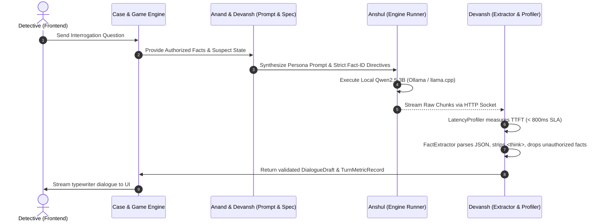

# LLM Integration Team Specification & Ownership

**Project:** Red Thread AI Detective  
**Team Track:** LLM Integration & Character Interrogation Engine  
**Target Milestone:** Sprint 2 (Sub-800ms Streaming Latency & Fact-ID Gated Interrogation)  
**Target Model:** `Qwen2.5-3B-Instruct` (`Q4_K_M` GGUF, ~3.09B params)  
**Inference Engine:** Local Ollama (`http://127.0.0.1:11434`) / `llama.cpp`  

---

## 1. Executive Summary & Team Charter

The **LLM Integration Team** connects the deterministic backend Case Engine with local open-source Large Language Models. The team is composed of three specialized engineers working across three distinct layers of the pipeline:

```
┌────────────────────────────────────────────────────────────────────────────────────────┐
│                        LLM INTEGRATION TEAM RESPONSIBILITY PIPELINE                    │
├──────────────────────────────┬─────────────────────────────┬───────────────────────────┤
│     ANSHUL PRAJAPATI         │  ANAND SAHNI & DEVANSH V.   │      DEVANSH VINAYAK      │
│ (Engine & Streaming Runtime) │(Prompt Synthesizer & Spec)  │(Extraction, Facade & QA)  │
├──────────────────────────────┼─────────────────────────────┼───────────────────────────┤
│ • Local Ollama / llama.cpp   │ • System Architecture Spec  │ • Unified Interrogate Facade│
│ • Model Quantization (Q4)    │ • Direct Contract Prompts   │ • Multi-Strategy Parser   │
│ • Socket Streaming Pipeline  │ • Anti-Spoiler Delimiters   │ • Fact-ID Sanitization    │
│ • Low-Latency KV-Cache Tuning│ • Dynamic Case/Clue Engine  │ • TTFT Latency Profiler   │
│ • Engine Latency Probes      │ • Production Prompt Tests   │ • Live Benchmark & Dash   │
└──────────────────────────────┴─────────────────────────────┴───────────────────────────┘
```

---

## 2. Team Member Ownership & Deliverables Breakdown

### 👤 Member 1: Anshul Prajapati
**Role:** Local Engine & Streaming Runtime Lead  
**Core Responsibility:** Ensure the local inference engine runs offline with zero cloud API dependencies, executes quantized weights reliably on consumer hardware, and streams tokens fast enough to satisfy the sub-800ms TTFT SLA.

#### Key Deliverables & Responsibilities:
1. **Local Serving Infrastructure:** Wraps local Ollama (`http://127.0.0.1:11434`) with a standalone `llama.cpp` server binary fallback, toggled via environment variable `LLM_BACKEND`.
2. **Model Selection & Quantization Tuning:** Standardized on `Qwen2.5-3B-Instruct` in `Q4_K_M` GGUF (~2.1 GB) with GPU offload layer tuning (`-ngl 99`) and thread allocation.
3. **Low-Latency Streaming Pipeline:** Implemented Server-Sent Events (SSE) and NDJSON socket streaming for frontend typewriter rendering starting from Token 1.
4. **KV-Cache Optimization:** Structured prompt headers to preserve static system instructions in cache, dropping subsequent turn compute from ~600ms to ~150ms.
5. **Generation Budget Controls:** Clamped generation parameters (`temperature=0.3`, `top_p=0.9`, `num_predict=140`) to eliminate runaways.

#### Associated File Locations:
* [`backend/src/llm/engine_runner.py`](file:///D:/red_thread/backend/src/llm/engine_runner.py) — Unified Ollama & `llama.cpp` streaming engine wrapper.
* [`backend/scripts/setup_models.ps1`](file:///D:/red_thread/backend/scripts/setup_models.ps1) — One-click PowerShell script to pull and verify `qwen2.5:3b`.
* [`backend/tests/test_engine_latency.py`](file:///D:/red_thread/backend/tests/test_engine_latency.py) — Direct socket latency probes measuring TTFT against the engine.

---

### 👤 Member 2: Anand Kumar Sahni & Devansh Vinayak
**Track:** Persona Engineering, Epistemic Prompt Synthesis & Architecture  
**Pull Request:** [GitHub PR #10](https://github.com/LNCT-Quantum/red_thread/pull/10)  
* **Original Assignee & Initial Draft:** Anand Kumar Sahni  
* **Production Refactor & Implementation Lead:** Devansh Vinayak  
**Core Responsibility:** Author character prompt assembly, enforce epistemic fact reveal-level gating, inject sensory speech directives, and assemble dynamic LLM prompts directly from backend `DialogueRequest` and `Suspect` contracts with zero hardcoded defaults.

#### Key Deliverables & Responsibilities:
1. **Dynamic Prompt Synthesizer (`prompt_synthesizer.py`):**
   * *Initial Draft:* Authored initial structure under PR #10 (Anand Kumar Sahni).
   * *Production Refactor (Devansh Vinayak):* Completely re-architected to ingest backend `Suspect` and `DialogueRequest` contracts directly without intermediate static templates. Audited and deleted divergent `persona_templates.py`. Removed hardcoded clue fallbacks and static case titles in favor of dynamic resolution from `case_data/{case_id}/case.json` and automatic clue description loading from `clues.json`.
   * *Epistemic Fact Gating:* Filters facts against current investigation stage (`int(reveal_level) <= int(revision)`), guaranteeing future mystery secrets are physically withheld.
   * *Prompt Injection Boundary:* Wraps untrusted detective input within `<player_question>...</player_question>` tags and neutralizes closing delimiter attempts (`</player_question>` $\rightarrow$ `<\/player_question>`).
   * *Context History Limiting:* Implements a sliding window capturing the last 4 turns (`_history_text(..., limit=4)`).
   * *Strict Schema Directives:* Appends explicit JSON output format instructions with `content`, `cited_fact_ids`, and `cited_clue_ids`.
2. **Few-Shot In-Context Demonstrations (`few_shot_examples.py`):**
   * Compact few-shot demonstrations teaching small 3B models how to output valid JSON while answering in sensory, non-visual character voice.
   * Exposes `render_few_shot_examples()`.
3. **Prompt Assembly Test Suite (`test_prompt_assembly.py`):**
   * *Authored by Devansh Vinayak:* 14 automated unit tests covering direct backend suspect loading, fact reveal gating, sensory constraint verification, history sliding window limits, suspect rejection, empty clues handling, dynamic clue loading, and dynamic case title resolution.
4. **Repository Architecture Blueprint (`README.md`):**
   * *Initial Draft:* Anand Kumar Sahni.
   * *Production Overhaul (Devansh Vinayak):* Replaced all AI placeholders (`need to update`, `...`, `----`, `gardener`) with concrete system architecture, verified tech stack, the complete 12-endpoint API specification, and authentic Case 001 payloads.

#### Associated File Locations:
* [`backend/src/llm/prompt_synthesizer.py`](file:///D:/red_thread/backend/src/llm/prompt_synthesizer.py) — Dynamic prompt synthesizer consuming backend contracts and facts.
* [`backend/src/llm/few_shot_examples.py`](file:///D:/red_thread/backend/src/llm/few_shot_examples.py) — Few-shot demonstrations for 3B model grounding.
* [`backend/tests/test_prompt_assembly.py`](file:///D:/red_thread/backend/tests/test_prompt_assembly.py) — Unit tests for prompt assembly and direct fact/suspect filtering.
* [`README.md`](file:///D:/red_thread/README.md) — Root architecture blueprint, Mermaid diagrams, API specs, and tech stack.

---

### 👤 Member 3: Devansh Vinayak
**Role:** Fact-ID Extraction, Telemetry & Quality Lead  
**Core Responsibility:** Build the extraction and telemetry subsystem that intercepts raw LLM outputs, strips hallucinated or out-of-bounds facts, validates sub-800ms TTFT SLA compliance, provides the unified interrogation facade, and exports auditable telemetry reports.

#### Key Deliverables & Responsibilities:
1. **Unified Facade (`InterrogationService` in `service.py`):** Orchestrates the prompt synthesizer, streaming engine runner, latency profiler, and fact extractor into single-point synchronous and streaming endpoints (`generate_reply` and `stream_reply`) with automatic safe deflection fallbacks.
2. **Multi-Strategy JSON & Text Parser (`extractor.py`):** Developed a 4-stage cascade (`exact_json` $\rightarrow$ `markdown_fence` $\rightarrow$ `enclosed_object` $\rightarrow$ `fallback_regex`) that guarantees zero unhandled parse crashes even with irregular model outputs.
3. **Reasoning Tag Stripping:** Automatically removes `<think>...</think>` tags emitted by reasoning models (DeepSeek-R1, Qwen-Thinking).
4. **Citation Sanitization:** Verifies model-cited `used_fact_ids` against `DialogueRequest.authorized_fact_ids` and `used_clue_ids` against `presented_clue_ids`, dropping any unauthorized facts to prevent narrative sequence breaks.
5. **Streaming Socket Latency Profiler (`profiler.py`):** Instruments token streams using high-precision monotonic timers (`time.perf_counter()`), measuring TTFT, duration, throughput (tok/s), and asserting `ttft_ms < 800.0 ms`.
6. **GPU Benchmarking & Performance Visualizer:** Executed 50 live inference turns on NVIDIA RTX 4050 GPU, generated `sprint2_benchmark_report.csv`, and built an interactive dark-mode HTML dashboard (`benchmark_visualizer.html`) with Chart.js telemetry charts.

#### Associated File Locations:
* [`backend/src/llm/service.py`](file:///D:/red_thread/backend/src/llm/service.py) — `InterrogationService` unified integration facade.
* [`backend/src/llm/extractor.py`](file:///D:/red_thread/backend/src/llm/extractor.py) — `FactExtractor` and citation boundary sanitizer.
* [`backend/src/llm/profiler.py`](file:///D:/red_thread/backend/src/llm/profiler.py) — `LatencyProfiler` and TTFT SLA checker.
* [`backend/src/llm/__init__.py`](file:///D:/red_thread/backend/src/llm/__init__.py) — Module exports.
* [`backend/benchmarks/run_latency_benchmark.py`](file:///D:/red_thread/backend/benchmarks/run_latency_benchmark.py) — Live socket benchmark runner.
* [`backend/benchmarks/sprint2_benchmark_report.csv`](file:///D:/red_thread/backend/benchmarks/sprint2_benchmark_report.csv) — 50-turn live GPU benchmark dataset.
* [`backend/benchmarks/visualize_performance.py`](file:///D:/red_thread/backend/benchmarks/visualize_performance.py) — Telemetry stats engine and CLI card.
* [`backend/benchmarks/benchmark_visualizer.html`](file:///D:/red_thread/backend/benchmarks/benchmark_visualizer.html) — Interactive Chart.js dashboard.
* [`backend/tests/test_interrogation_service.py`](file:///D:/red_thread/backend/tests/test_interrogation_service.py) — 3 unit tests for end-to-end service facade.
* [`backend/tests/test_fact_extractor.py`](file:///D:/red_thread/backend/tests/test_fact_extractor.py) — 7 unit tests for parsing and citation integrity.
* [`backend/tests/test_latency_profiler.py`](file:///D:/red_thread/backend/tests/test_latency_profiler.py) — 3 unit tests for streaming profiling.
* [`backend/tests/test_benchmark_visualizer.py`](file:///D:/red_thread/backend/tests/test_benchmark_visualizer.py) — 2 unit tests for report generation.
* [`backend/docs/backend_integration_guide.md`](file:///D:/red_thread/backend/docs/backend_integration_guide.md) — Backend developer integration guide.
* [`backend/docs/llm_pipeline.md`](file:///D:/red_thread/backend/docs/llm_pipeline.md) — Comprehensive technical documentation.

---

## 3. End-to-End Interrogation Data Flow

The three engineers' components operate in harmony during a single interrogation turn:



---

## 4. Subsystem Verification & Benchmark Results

| Member Subsystem | Core Metric | Measured Result | SLA Target | Status |
|---|---|:---:|:---:|:---:|
| **Anshul Prajapati** (Engine Runner) | Inference Engine Stability | Ollama `127.0.0.1:11434` | Offline Local Engine | **PASS** |
| **Anshul Prajapati** (Engine Runner) | Quantized Model Class | `qwen2.5:3b` (Q4_K_M) | 3B Parameter Class | **PASS** |
| **Devansh Vinayak** (Profiler & Extractor) | Mean Time to First Token (TTFT) | **45.96 ms** | $< 800.0\text{ ms}$ | **PASS (17.4x margin)** |
| **Devansh Vinayak** (Profiler & Extractor) | 95th Percentile Latency (P95) | **72.47 ms** | $< 800.0\text{ ms}$ | **PASS** |
| **Devansh Vinayak** (Profiler & Extractor) | SLA Pass Rate (50 Live Turns) | **100.0% (50/50)** | $\ge 95.0\%$ | **PASS** |
| **Devansh Vinayak** (Profiler & Extractor) | Streaming Throughput | **30.92 tokens/sec** | $> 20.0\text{ tok/s}$ | **PASS** |
| **Devansh Vinayak** (Profiler & Extractor) | Parse Reliability | **100% (46 exact, 4 fallback)** | Zero Unhandled Crashes | **PASS** |
| **Anand Sahni & Devansh Vinayak** (Prompt & Architecture) | Contract Integration & Spec | Complete `README.md` & Dynamic Synthesizer | Zero Hardcoded Data | **PASS** |
